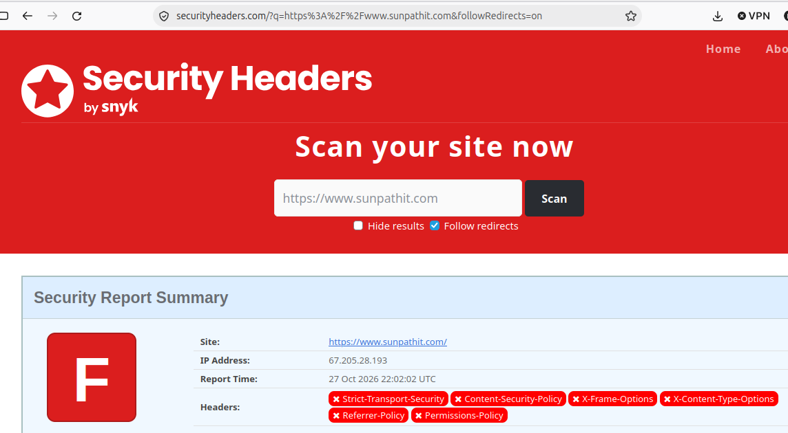
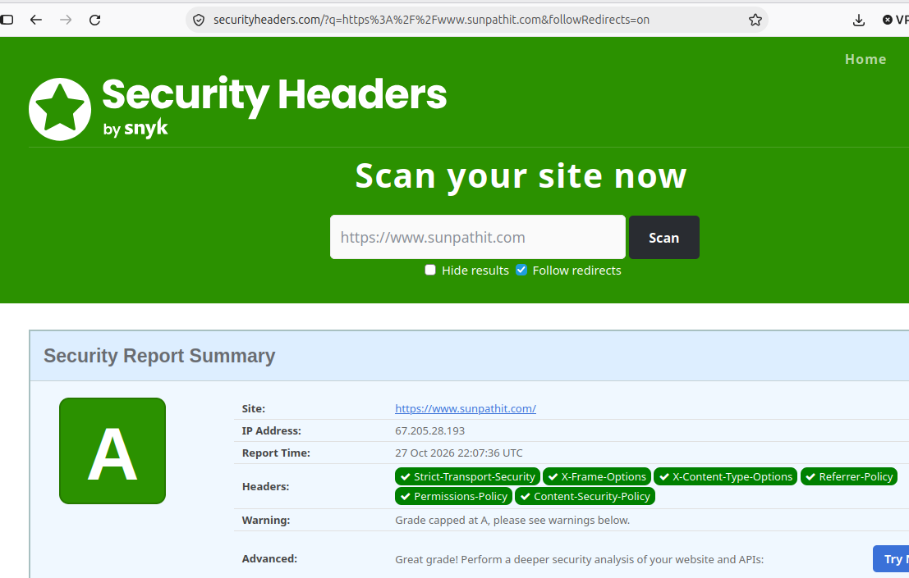

**SunPath IT Security Header Hardening**

Documented WordPress HTTP security header hardening using .htaccess, with before-and-after verification.

Cybersecurity and maintaining a mindful, well-thought-out security posture are essential parts of maintaining reliable business infrastructure today. It's a non-negotiable. A website may be functioning well and loading quickly while still missing important browser security protections. This creates unnecessary exposure for the business and its website visitors. Performing routine technical maintenance helps identify and address these security gaps before they become larger problems.

While performing routine security maintenance on my WordPress website, I was reviewing my PHP version to ensure it was up to date, which thankfully it was. During this process, I also evaluated my website's HTTP security headers using SecurityHeaders.com. My initial assessment identified six missing security headers, as shown in the image below, and returned an F grade, indicating an opportunity to improve my website's browser security posture.

I investigated the findings to understand what the missing headers meant and accessed my website's `.htaccess` configuration through DreamHost to implement the necessary changes. After making the updates, I performed another security assessment to validate the results. The website's security header grade improved from F to A. This project documents the investigation, configuration changes, and verification process.

**Objectives**
- Assess the website's existing HTTP security posture.
- Identify missing security headers and their functions.
- Determine appropriate security configuration improvements.
- Implement the changes through the `.htaccess` file.
- Verify the configuration using an independent security header assessment.
- Document the findings, results, and business value.

**Initial Security Header Assessment**

- The SecurityHeaders.com assessment returned an F grade and identified six missing HTTP security headers.
- Missing headers included Strict-Transport-Security (HTTPS enforcement), Content-Security-Policy (content loading restrictions), X-Frame-Options (framing and clickjacking protection), X-Content-Type-Options (MIME sniffing protection), Referrer-Policy (referrer information control), and Permissions-Policy (browser feature restrictions).

**Security Header Verification**

- Updated the WordPress website's `.htaccess` configuration through DreamHost to address the missing HTTP security headers.
- A subsequent SecurityHeaders.com assessment recognized all six security headers and returned an A grade, compared with the original F grade.

**Lessons Learned**
- Routine website security maintenance can reveal configuration gaps that are not immediately visible.
- HTTP security headers provide important browser-level protections and contribute to a defense-in-depth security approach.
- Website configuration changes should be tested and independently verified rather than assumed successful.
- A strong security header grade represents one component of website security and does not guarantee that a website is free of vulnerabilities.
- Documenting technical changes creates a repeatable process for future website maintenance and security improvements.

**Summary**
This project documents practical security-hardening improvements to my SunPath IT WordPress website. By identifying missing HTTP security headers, implementing configuration changes through the .htaccess file in DreamHost, and independently verifying the results, I significantly improved my website's security header assessment from F to A.

This project demonstrates how proactive maintenance, technical troubleshooting, configuration management, and independent validation contribute to maintaining a reliable website and strengthening its overall security posture.

**Navigation**

[`Back to GitHub Profile`](https://www.github.com/cbueker-it)

